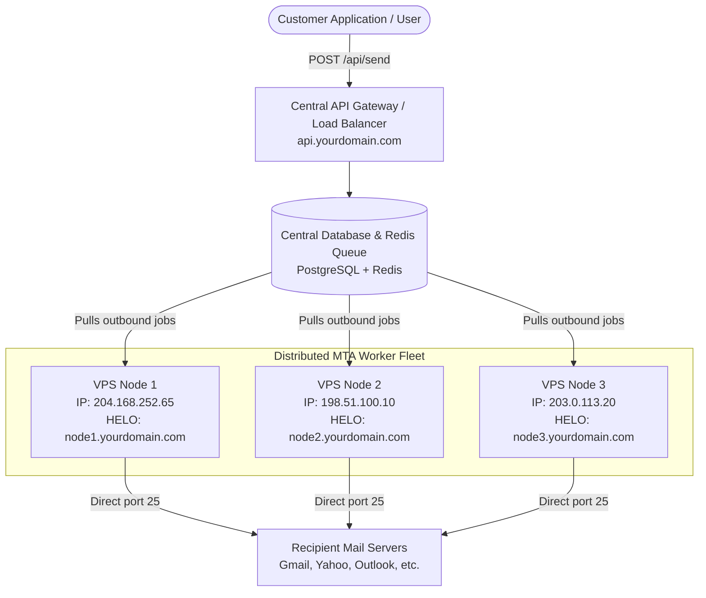

# Multi-Node & Multi-Domain Architecture Guide (Resend-Style Email Service)

This guide explains how to build a scalable, multi-VPS transactional email platform (similar to **Resend**, **SendGrid**, or **Postmark**) where:
1. Customers add domains with a single centralized DNS setup.
2. Multiple sending VPS nodes share the load across multiple IPs.
3. Adding new VPS nodes requires **zero DNS changes** from your customers.

---

## 1. High-Level Architecture Diagram



---

## 2. Centralized DNS Setup Strategy

### A. Centralized SPF (`include:` Mechanism)

Instead of asking your customers to list every individual VPS IP in their SPF record, use the **SPF `include:` mechanism** (the exact method used by Google, Microsoft, and Resend).

#### What your customers add to their domain DNS:
```text
Type  : TXT
Name  : @ (or customerdomain.com)
Value : v=spf1 include:spf.yourdomain.com ~all
```

#### What YOU control on your primary domain (`yourdomain.com`):
In your Cloudflare / DNS provider, manage a single central SPF record:
```text
Type  : TXT
Name  : spf.yourdomain.com
Value : v=spf1 ip4:204.168.252.65 ip4:NODE2_IP ip4:NODE3_IP ip4:NODE4_IP ~all
```

> **Why this matters**: When you add Node 2, Node 3, or Node 50, your customers **never touch their DNS again**. You simply add the new IP to `spf.yourdomain.com`, and it takes effect globally.

---

### B. Centralized DKIM Signing

DKIM is cryptographic (public/private key). It is **IP-agnostic** — remote mail servers do not care which VPS IP transmitted the email as long as the cryptographic signature matches the public key in DNS.

1. **When a customer adds a domain in your dashboard**:
   - Your system generates an RSA 2048 keypair.
   - The private key is saved in your central database.
   - The customer adds the public key in their DNS:
     ```text
     Type  : TXT
     Name  : default._domainkey.customerdomain.com
     Value : v=DKIM1; k=rsa; p=MIIBIjANBgkqhkiG9w0BAQEFAAOCAQ8...
     ```
2. **During transmission**:
   - Any worker node (Node 1, Node 2, etc.) fetches the private key from the central database, signs the message headers, and dispatches the email.
   - Gmail/Yahoo queries `default._domainkey.customerdomain.com`, verifies the cryptographic signature, and marks the email as **DKIM: PASS**.

---

### C. FCrDNS (Forward-Confirmed Reverse DNS) per Node

Under Gmail and Yahoo's official sender policies, every sending server IP **must have a valid Reverse DNS (PTR) record** that matches the hostname announced in the SMTP `HELO/EHLO` greeting.

For each VPS node in your cluster, configure a dedicated subdomain:

| Node | Public IP | Cloudflare A Record (Gray Cloud ☁️) | VPS Provider PTR (Reverse DNS) | Container Environment |
| :--- | :--- | :--- | :--- | :--- |
| **Node 1** | `204.168.252.65` | `node1.yourdomain.com` → `204.168.252.65` | `node1.yourdomain.com` | `HELO_HOST=node1.yourdomain.com` |
| **Node 2** | `198.51.100.10` | `node2.yourdomain.com` → `198.51.100.10` | `node2.yourdomain.com` | `HELO_HOST=node2.yourdomain.com` |
| **Node 3** | `203.0.113.20` | `node3.yourdomain.com` → `203.0.113.20` | `node3.yourdomain.com` | `HELO_HOST=node3.yourdomain.com` |

#### How Google Verifies FCrDNS:
1. Node 1 connects to Google MX and says: `EHLO node1.yourdomain.com`.
2. Google looks up PTR for `204.168.252.65` → gets `node1.yourdomain.com` (Match ✅).
3. Google looks up A record for `node1.yourdomain.com` → gets `204.168.252.65` (Match ✅).
4. Google grants **100% Forward-Confirmed Reverse DNS alignment**.

---

### D. Return-Path (Custom Bounce Subdomain)

To prevent recipient mail servers from exposing raw node IPs in the `Return-Path`, configure a custom bounce domain:

#### Customer DNS:
```text
Type  : CNAME
Name  : bounces.customerdomain.com
Value : mta.yourdomain.com
```

#### Your Primary Domain DNS:
```text
Type  : A
Name  : mta.yourdomain.com
Value : 204.168.252.65 (DNS only / Gray cloud)
```

In outgoing email headers:
```text
Return-Path: <bounce+job_id@bounces.customerdomain.com>
```

---

## 3. Customer Onboarding Checklist (What Customers Add)

When a customer registers their domain `brand.com` on your platform, show them these 3 records:

| Record Type | Host / Name | Value | Purpose |
| :--- | :--- | :--- | :--- |
| **TXT** | `@` | `v=spf1 include:spf.yourdomain.com ~all` | Authorizes your server cluster |
| **TXT** | `default._domainkey` | `v=DKIM1; k=rsa; p=<PUBLIC_KEY>` | Cryptographic sender validation |
| **TXT** | `_dmarc` | `v=DMARC1; p=none; sp=none; rua=mailto:dmarc@yourdomain.com` | Anti-spoofing policy & reporting |

---

## 4. Multi-VPS Deployment Workflow

### Step 1: Spin up a new VPS (Node 2)
1. Launch an Ubuntu/AlmaLinux/Debian VPS.
2. Note the new public IP (e.g. `198.51.100.10`).

### Step 2: Configure DNS & Reverse DNS
1. In Cloudflare, add an `A` record (Gray Cloud):
   ```text
   node2.yourdomain.com → 198.51.100.10
   ```
2. In your VPS hosting provider console (Hetzner, DigitalOcean, etc.), set Reverse DNS (PTR) for `198.51.100.10` to:
   ```text
   node2.yourdomain.com
   ```
3. In Cloudflare, update `spf.yourdomain.com` to include the new IP:
   ```text
   v=spf1 ip4:204.168.252.65 ip4:198.51.100.10 ~all
   ```

### Step 3: Launch Docker on the Node
Clone the repo on Node 2 and set `HELO_HOST=node2.yourdomain.com` in `docker-compose.yml`:
```yaml
environment:
  - NODE_ENV=production
  - PORT=3000
  - INBOUND_PORT=25
  - CONCURRENCY=25
  - HELO_HOST=node2.yourdomain.com
  - API_PASSWORD=sec_your_cluster_secret_key
```

Run:
```bash
bash docker-deploy.sh
```

---

## 5. Scaling to Centralized State (Postgres + Redis)

For large clusters (millions of emails/day), move from local SQLite to a shared state pool:

1. **Central Database (PostgreSQL)**:
   - Stores `domains`, `dkim_keys`, `api_keys`, `suppression_list`, and delivery logs.
2. **Central Job Queue (Redis + BullMQ)**:
   - Central API server receives customer send requests (`POST /v1/send`) and pushes jobs to Redis.
   - Worker nodes (`Node 1`, `Node 2`, `Node 3`) pull jobs from Redis and transmit them directly to recipient MX servers.
   - Bounces and delivery statuses are written back to PostgreSQL.
